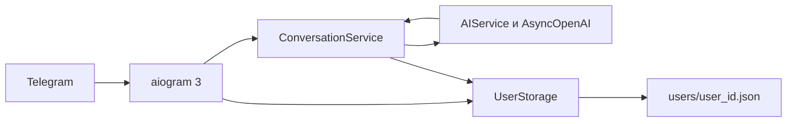
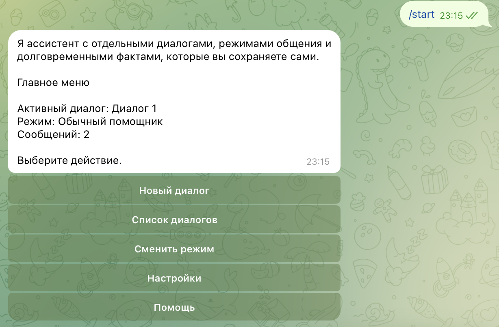
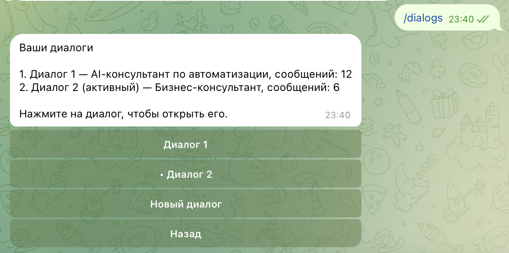
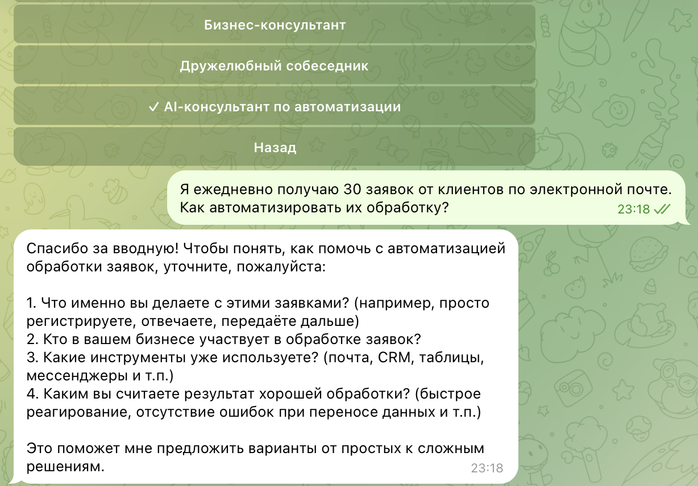
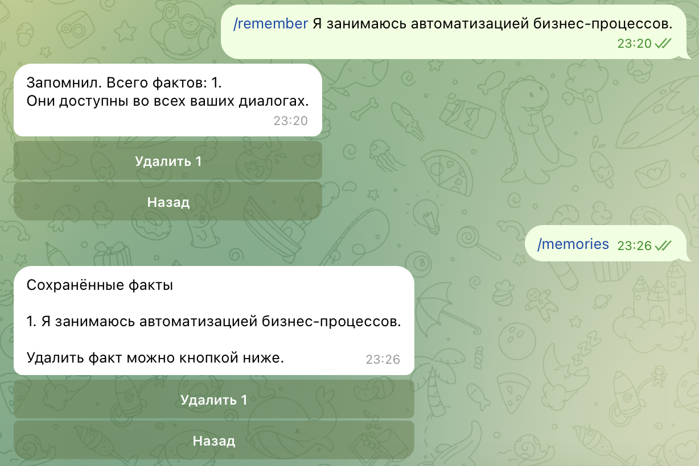
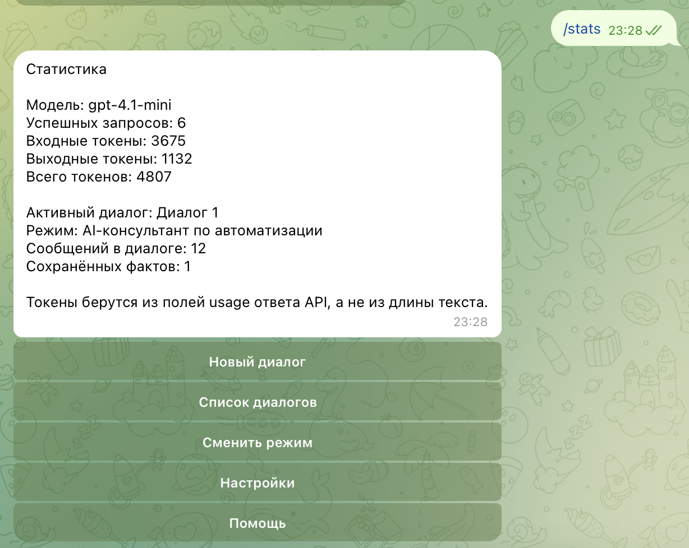

# Telegram AI Assistant

Асинхронный Telegram-бот для домашнего задания VPf09. Он ведёт несколько независимых диалогов, переключает режим общения и хранит состояние в JSON. Модель по умолчанию — `gpt-4.1-mini`.

Задание сформулировано для бота ВКонтакте и ProxyAPI. В этой работе мессенджер заменён на Telegram, а доступ к модели — на официальный OpenAI API. Это адаптация задания, а не буквальное использование VKBottle и ProxyAPI.

Бот проверен в личном чате Telegram: меню, режимы, память и статистика отвечают через OpenAI API. Автоматические тесты по-прежнему ходят в поддельный клиент и не делают платных запросов.

## Возможности Telegram-бота

- Команды `/start`, `/menu`, `/help`, `/dialogs`, `/reset`, `/stats`, `/remember`, `/memories` и `/cancel`.
- Главное меню: новый диалог, список диалогов, смена режима, настройки и помощь. У экранов есть возврат назад.
- Шесть режимов с отдельными системными инструкциями. Смена режима затрагивает только активный диалог.
- Несколько диалогов у одного пользователя: создание, список, переключение, переименование, очистка истории и удаление с подтверждением. Единственный диалог удалить нельзя.
- Краткосрочная история диалога и долгосрочные факты, которые пользователь сохраняет сам.
- Статус «печатает» во время генерации, отказ от второго запроса в тот же диалог, защита от повторного нажатия кнопки и разбиение длинного ответа на сообщения Telegram.
- Учёт токенов по полям `usage` ответа API.

## Шесть режимов общения

Режим хранится в активном диалоге и выбирается кнопкой «Сменить режим».

| Режим | Для чего |
|---|---|
| Обычный помощник | Повседневные вопросы и аккуратные ответы |
| Программист | Код, ошибки и разбор технических решений |
| Преподаватель | Последовательное объяснение с примером |
| Бизнес-консультант | Аудитория, риски и ближайший шаг |
| Дружелюбный собеседник | Спокойный разговор без давления |
| AI-консультант по автоматизации | Разбор бизнес-процесса, поиск повторяющихся операций и варианты автоматизации от простого к сложному |

Консультант по автоматизации не достраивает процесс, которого пользователь не описывал. Если данных мало, он спрашивает, кто участвует, как часто выполняется работа, какие инструменты уже есть и что считается хорошим результатом.

## Архитектура

Цепочка обработки: Telegram → aiogram → OpenAI API → JSON.



1. aiogram принимает команду, кнопку или текст в личном чате.
2. `ConversationService` собирает контекст активного диалога: системная инструкция режима, явно сохранённые факты, история и новое сообщение.
3. `AIService` вызывает официальный `AsyncOpenAI` и читает фактический `usage`.
4. `UserStorage` записывает `users/<user_id>.json` через временный файл и `os.replace`. Параллельные изменения одного пользователя сериализуются блокировкой. При ошибке API история не меняется.

## Структура проекта

```text
.
├── bot
│   ├── main.py            # запуск: python -m bot
│   ├── config.py          # переменные окружения
│   ├── models.py          # диалоги, факты, статистика
│   ├── modes.py           # шесть режимов
│   ├── storage.py         # JSON, блокировка, атомарная запись
│   ├── context.py         # сборка запроса к модели
│   ├── ai_service.py      # AsyncOpenAI
│   ├── conversation.py    # один ход диалога
│   ├── guards.py          # занятый диалог и повтор callback
│   └── handlers           # команды, кнопки, FSM и обычный текст
├── tests                  # pytest с подменой OpenAI
├── users                  # локальные users/<id>.json, в Git не входят
├── screenshots            # снимки реальной проверки в Telegram
├── .env.example
├── .gitignore
├── requirements.txt
├── pytest.ini
└── README.md
```

## Требования и установка

Нужен Python 3.11 или новее.

macOS: Python с python.org или Homebrew (`brew install python@3.11`).

Linux: пакет дистрибутива, например `sudo apt install python3 python3-venv python3-pip` на Debian/Ubuntu или `sudo dnf install python3` на Fedora.

В каталоге проекта:

```bash
python3 --version
python3 -m venv .venv
source .venv/bin/activate
python -m pip install --upgrade pip
pip install -r requirements.txt
```

Зависимости: aiogram 3, официальный пакет `openai`, python-dotenv, pytest и pytest-asyncio. SQLite и PostgreSQL не используются.

## Настройка .env

```bash
cp .env.example .env
```

В `.env.example` секретов нет. В локальный `.env` записываются свои значения:

```text
BOT_TOKEN=
OPENAI_API_KEY=
OPENAI_MODEL=gpt-4.1-mini
MAX_HISTORY_MESSAGES=100
MAX_OUTPUT_TOKENS=1200
```

`BOT_TOKEN` выдаёт @BotFather. `OPENAI_API_KEY` берётся в кабинете OpenAI. Оба поля обязательны. Модель по умолчанию — `gpt-4.1-mini`, история ограничена 100 сообщениями, один ответ — 1200 токенами. Файл `.env` указан в `.gitignore` и не публикуется.

Пути к `.env` и к каталогу `users` считаются от корня проекта.

## Запуск

```bash
source .venv/bin/activate
python -m bot
```

Остановка — Ctrl+C. Второй процесс с тем же токеном запускать не нужно: Telegram отдаёт обновления только одному polling-клиенту. Бот рассчитан на личный чат. В группе он отвечает только на `/start` и просит написать ему напрямую.

## Команды Telegram-бота

| Команда | Действие |
|---|---|
| `/start` | Запуск и главное меню |
| `/menu` | Главное меню |
| `/help` | Справка |
| `/dialogs` | Список диалогов |
| `/reset` | Очистка истории активного диалога после подтверждения |
| `/stats` | Статистика токенов |
| `/remember текст` | Сохранить факт |
| `/memories` | Показать сохранённые факты |
| `/cancel` | Отменить переименование или ввод факта |

Пустое сообщение и текст длиннее 4000 символов в модель не отправляются.

## Краткосрочная и долгосрочная память

Краткосрочная память — это история активного диалога. В ней хранятся роль, текст и время сообщения. В файл попадают последние 100 сообщений. Перед запросом к модели более старые реплики дополнительно отбрасываются, если они не помещаются в окно контекста. Оценка для этого отсечения служебная и в статистику не записывается.

Долгосрочная память включается только явно:

- `/remember текст` сразу сохраняет факт;
- `/remember` без текста просит прислать его следующим сообщением;
- `/memories` показывает факты и даёт удалить выбранный;
- одному пользователю доступно до 30 фактов, каждый до 500 символов;
- факты доступны во всех диалогах этого пользователя и не видны другому пользователю;
- фраза вроде «запомни, что...» сама по себе факт не создаёт.

## Управление независимыми диалогами

У каждого диалога есть собственный идентификатор, название, режим, дата создания и история. Новый диалог начинается в режиме обычного помощника и становится активным. Переименование идёт через FSM: бот ждёт следующее текстовое название, `/cancel` отменяет ввод.

Удаление спрашивает подтверждение и запрещено, если диалог остался один. Очистка истории не удаляет диалог, его режим и долгосрочные факты. Сообщение пользователя попадает только в активный диалог. В локальной проверке к моменту подготовки уже были два диалога: «Диалог 1» в режиме консультанта по автоматизации и «Диалог 2» в режиме бизнес-консультанта. Их тексты в репозиторий не входят.

## Учёт токенов

Модель по умолчанию — `gpt-4.1-mini`. Для неё в коде указано опубликованное окно контекста 1 047 576 токенов. Неизвестная модель получает запас 128 000 токенов, чтобы запрос не раздувался.

После успешного ответа бот берёт из `usage` сначала `input_tokens` и `output_tokens`, а если их нет — `prompt_tokens` и `completion_tokens`. Длина текста в статистику не подставляется. Неуспешный запрос счётчики и историю не меняет. Команда `/stats` показывает накопленные значения.

На снимке `screenshots/05_stats.png`, сделанном во время проверки в Telegram, видны такие счётчики: 6 успешных запросов, 3675 входных токенов, 1132 выходных, всего 4807. Активным был «Диалог 1» в режиме AI-консультанта по автоматизации, в нём 12 сообщений и 1 сохранённый факт.

Это снимок на момент демонстрации. Позже локальный `users/<user_id>.json`, который не публикуется, содержал уже 9 успешных запросов, 4684 входных и 1623 выходных токена: после снимка диалог продолжался. Секретов API в этом файле нет.

## Демонстрация работы

Снимки сделаны в реальном Telegram. Рядом с каждым кадром — то, что на нём видно.

### Главное меню



Команда `/start` открывает меню. На снимке активен «Диалог 1» в режиме обычного помощника. Кнопки: новый диалог, список диалогов, смена режима, настройки и помощь.

### Диалоги и ответ в переписке



Файл называется `02_dialogs.png`. На кадре видна нижняя часть списка режимов и ответ бота в переписке. Отдельный экран «Ваши диалоги» здесь не показан.

### AI-консультант по автоматизации



В меню режимов отмечен «AI-консультант по автоматизации». На вопрос о 30 заявках с почты бот не предлагает готовое внедрение, а уточняет шаги, участников, текущие инструменты и ожидаемый результат.

### Долгосрочная память



Команда `/remember` сохраняет факт «Я занимаюсь автоматизацией бизнес-процессов» и сообщает, что он доступен во всех диалогах. `/memories` показывает этот факт и кнопку удаления.

### Статистика токенов



`/stats` показывает модель `gpt-4.1-mini`, 6 успешных запросов, 3675 входных и 1132 выходных токена. Режим активного диалога на этом кадре — AI-консультант по автоматизации.

## Тестирование

Тесты не требуют `.env` и не обращаются к OpenAI.

```bash
source .venv/bin/activate
python -m pytest -q
```

Покрыты создание и удаление диалогов, переключение активного диалога, смена режима, изоляция пользователей, ограничение истории, запись и загрузка JSON, долгосрочные факты, сборка контекста, ошибки API, учёт токенов, повтор callback и разбиение длинного текста.

Финальный прогон перед публикацией:

```text
38 passed in 0.16s
```

Дополнительно `python -m compileall -q bot tests` и импорт пакетов `bot.main`, `bot.handlers`, `bot.ai_service`, `bot.storage`, `bot.conversation`, `bot.context`, `bot.modes` завершились без ошибок. Платных запросов к OpenAI эти проверки не делают.

## Результаты выполнения домашнего задания VPf09

Сдан продвинутый вариант задания.

- Вместо бота ВКонтакте и VKBottle использован Telegram и aiogram 3.
- Вместо ProxyAPI использован официальный OpenAI API и `AsyncOpenAI`.
- Замена VK и ProxyAPI — адаптация задания, а не буквальное выполнение требований по этим сервисам.
- Добавлен шестой режим: AI-консультант по автоматизации. Именно он показан на демонстрационных снимках.
- Добавлена долгосрочная память: `/remember` и `/memories`. Факты не извлекаются автоматически.
- Реализованы независимые диалоги со своей историей и своим режимом. Контекст сохраняется в `users/<user_id>.json`.
- Модель `gpt-4.1-mini` выбрана как текстовый ассистент с большим окном контекста и умеренной стоимостью относительно старших моделей семейства GPT-4.1.
- Подтверждённый расход на снимке статистики: 3675 входных и 1132 выходных токена за 6 успешных запросов. Более поздний локальный файл, не входящий в Git, содержит 4684 входных и 1623 выходных токена за 9 запросов.

## Безопасность

- `BOT_TOKEN` и `OPENAI_API_KEY` читаются только из окружения. В коде и в `.env.example` их нет.
- `.gitignore` исключает `.env`, `.venv/`, `__pycache__/`, `.pytest_cache/`, `users/*.json`, `*.log` и `.DS_Store`.
- В Git не попадают блокировки, временные JSON и повреждённые копии файлов пользователей.
- Журнал пишет тип ошибки, а не текст сообщения, ключ или тело ответа API.
- Диалог ищется только внутри состояния текущего `user_id`. Имя файла строится как `users/<целое>.json` и проверяется на выход из каталога `users`.
- Файл с чужим `user_id` не принимается: он уходит в резервную копию, для текущего пользователя создаётся новое состояние.
- Локальный JSON проверки не содержит ключ API и токен бота.
